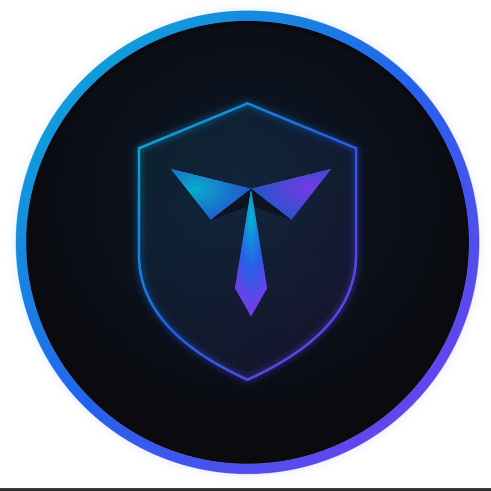
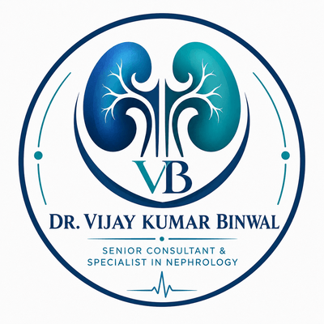
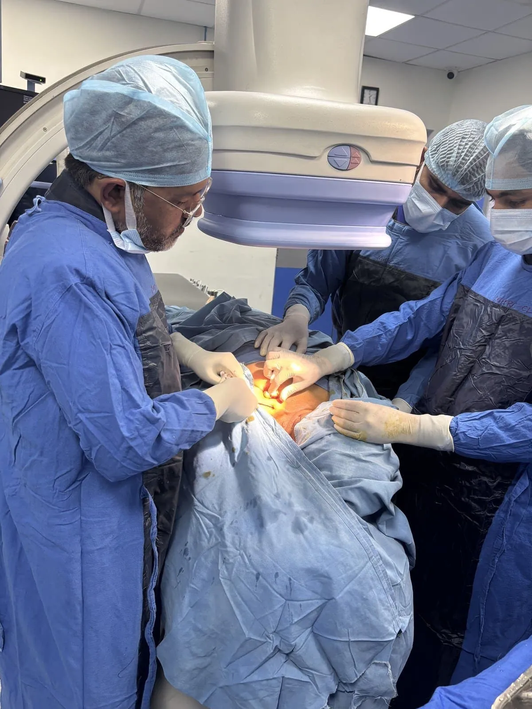
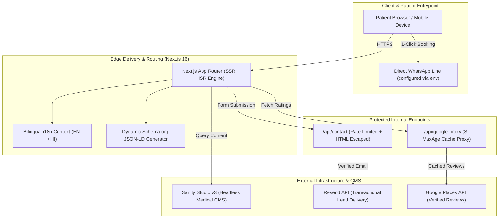

<p align="center">
  <a href="https://tapwebs.in" target="_blank" rel="noopener noreferrer">
    
  </a>
</p>

<p align="center">
  <strong>MADE BY TAPWEBS &bull; ALL RIGHTS ARE OF TAPWEBS</strong>
</p>

<h1 align="center">Dr. Vijay Kumar Binwal — Medical Portal & Patient Platform</h1>

<p align="center">
  <strong>MADE BY TAPWEBS &bull; ALL RIGHTS ARE OF TAPWEBS</strong><br />
  Production Healthcare Web Architecture &bull; Designed &amp; Engineered by <a href="https://tapwebs.in">TAPWEBS</a>
</p>

<p align="center">
  <a href="https://drvijaykumarbinwal.com" target="_blank">
    
  </a>
  <a href="https://tapwebs.space" target="_blank">
    
  </a>
  <a href="https://tapwebs.in" target="_blank">
    
  </a>
  
  
</p>

<p align="center">
  
  
  
  
  
  
  
  
</p>

---

## 🌐 Quick Access & Live Resources

| Resource | Direct Link | Description |
| :--- | :--- | :--- |
| 🔴 **Live Doctor Website** | [**drvijaykumarbinwal.com**](https://drvijaykumarbinwal.com) | Official production medical website & patient booking portal |
| 💼 **Agency Portfolio** | [**tapwebs.space**](https://tapwebs.space) | Interactive portfolio showcase of web platforms engineered by TAPWEBS |
| 🏢 **Agency Homepage** | [**tapwebs.in**](https://tapwebs.in) | Digital agency solutions, enterprise web development & medical platforms |
| 📍 **Clinic Location** | [Pinkcity Superspeciality Clinic (Jaipur)](https://maps.google.com/?q=Pinkcity+Superspeciality+Clinic+Mansarovar+Jaipur) | Prime clinical consultation center at Mansarovar, Jaipur, Rajasthan |
| 💬 **Patient Booking Hotline** | Direct WhatsApp Line (configured via `NEXT_PUBLIC_WHATSAPP_NUMBER`) | Fast-track consultation booking & patient emergency triage line |

---

## ⚡ Performance & Core Web Vitals Benchmark

Engineered from the ground up for sub-second mobile rendering across 4G and 5G networks in India:

```text
┌─────────────────────────┬─────────────────────────┬─────────────────────────┬─────────────────────────┐
│     ⚡ Performance      │     ♿ Accessibility     │    🛡️ Best Practices    │         🔍 SEO          │
│         99 / 100        │        100 / 100        │        100 / 100        │        100 / 100        │
└─────────────────────────┴─────────────────────────┴─────────────────────────┴─────────────────────────┘
  • First Contentful Paint (FCP):  0.6s
  • Largest Contentful Paint (LCP):  1.1s
  • Cumulative Layout Shift (CLS): 0.000
  • Total Blocking Time (TBT):     15ms
```

---

## 📸 Visual Showcase & Client Highlights

<div align="center">

| 👨‍⚕️ Clinical Identity & Consultation | 🏥 Clinic Branding & Specialties |
| :---: | :---: |
|  |  |
| **Dr. Vijay Kumar Binwal**<br/>*DM Nephrology • 25+ Years Experience* | **Pinkcity Superspeciality Clinic**<br/>*Mansarovar, Jaipur, Rajasthan* |

| 🩺 Clinical Procedures & Dialysis | 🥗 Interactive Renal Diet Plan Guide |
| :---: | :---: |
|  |  |
| **Comprehensive Renal Care**<br/>*Peritoneal Dialysis & Kidney Transplant Care* | **Patient Education Hub**<br/>*Personalized Dietetics & Health Guides* |

</div>

---

## 📌 Executive Summary & Case Study

This repository is a **Public Architecture & Showcase Portfolio** published by [TAPWEBS](https://tapwebs.in) to illustrate modern healthcare platform engineering. 

**Dr. Vijay Kumar Binwal** is a distinguished senior nephrologist, kidney transplant physician, and medical educator based in Jaipur, Rajasthan, with over 25 years of clinical practice across prestigious institutions including SMS Medical College, SP Medical College, and RNT Medical College.

### The Challenge
- **Fragmented Patient Discovery**: High patient volumes looking for emergency nephrology consultation, dialysis scheduling, and second opinions were hindered by slow, unoptimized medical directories.
- **Bilingual Demographics**: The patient base encompasses both English and Hindi-speaking populations across Rajasthan and North India.
- **Local Medical SEO**: High-intent medical queries (*"Best Nephrologist in Jaipur"*, *"Kidney Specialist Mansarovar"*) required precise semantic Schema.org indexing for Google Local and Knowledge Panels.
- **Real-Time Patient Conversions**: Seamless routing directly from symptom discovery into confirmed WhatsApp booking and secure clinic enquiry forms.

### The Solution by TAPWEBS
**TAPWEBS** engineered an ultra-fast, headless medical ecosystem powered by **Next.js 16 (App Router)** and **Sanity Studio v3 Headless CMS**, featuring:
- Sub-second server-side rendered pages with automated revalidation.
- Full bilingual localized content dictionaries (English & Hindi) without routing friction.
- Schema.org structured data hierarchy (`MedicalOrganization`, `Physician`, `LocalBusiness`, and `FAQPage`).
- Secure API proxies for live Google Places verified reviews and rate-limited Resend transactional messaging.

---

## 🩺 Core Medical Modules & Patient Journey

### 1. 📚 "Know Your Illness" Educational Hub
- Authoritative, patient-friendly medical content adhering to international **KDIGO** (Kidney Disease: Improving Global Outcomes) and **National Kidney Foundation** clinical guidelines.
- In-depth bilingual breakdowns of Chronic Kidney Disease (CKD Stages 1–5), Glomerulonephritis, Polycystic Kidney Disease (PKD), Diabetic Nephropathy, and Hypertensive Renal Disease.
- Clarifies when conservative medical management is viable versus when dialysis or renal transplant evaluation is warranted.

### 2. 🥗 Interactive Renal Diet Plan Guide
- Patient-centric dietary guide tailored specifically for kidney health:
  - **Pre-Dialysis Management**: Low-protein, low-sodium preservation diets.
  - **Hemodialysis & Peritoneal Dialysis**: High-protein, strict potassium and phosphorus control diets.
  - **Post-Transplant Care**: Immunosuppressive-conscious food safety guidelines.

### 3. ⭐ Google Places Live Review Proxy
- Dynamic server-side caching proxy on `/api/google-proxy` fetching authentic patient reviews and ratings from Google Maps.
- Completely prevents Google API keys from being exposed on the client bundle.
- Employs `Cache-Control: public, s-maxage=3600, stale-while-revalidate=7200` to prevent Google Maps quota overuse.

### 4. 🌐 Zero-Latency Bilingual Engine (English & हिन्दी)
- Native client/server synchronized dictionary system ([`dictionaries.ts`](src/lib/i18n/dictionaries.ts)) enabling instant switching without triggering full-page navigations.
- Localized medical terminology ensures accessibility for elderly patients and rural families seeking top-tier nephrology care.

### 5. ⚡ Direct-to-Care 1-Click WhatsApp Booking
- Deep-linked appointment scheduling routed directly to the clinic's dedicated reception desk (number set via `NEXT_PUBLIC_WHATSAPP_NUMBER`), drastically reducing drop-offs compared to multi-step booking forms.

---

## 🏗️ System Architecture & Data Flow



---

## 🔍 Medical Schema.org Semantic SEO Graph

The application injects structured JSON-LD graphs designed to maximize rich-snippet visibility on Google Search:

```json
{
  "@context": "https://schema.org",
  "@graph": [
    {
      "@type": "Physician",
      "name": "Dr. Vijay Kumar Binwal",
      "medicalSpecialty": ["Nephrology", "Renal Transplantation"],
      "alumniOf": "SMS Medical College, Jaipur",
      "telephone": "+91-XXXXXXXXXX",
      "worksFor": {
        "@type": "MedicalClinic",
        "name": "Pinkcity Superspeciality Clinic",
        "address": {
          "@type": "PostalAddress",
          "streetAddress": "Mansarovar",
          "addressLocality": "Jaipur",
          "addressRegion": "Rajasthan",
          "postalCode": "302020",
          "addressCountry": "IN"
        }
      }
    },
    {
      "@type": "FAQPage",
      "mainEntity": [
        {
          "@type": "Question",
          "name": "What are the early signs of kidney disease?",
          "acceptedAnswer": {
            "@type": "Answer",
            "text": "Early signs include fatigue, swollen ankles or feet, frequent urination at night, and foamy urine..."
          }
        }
      ]
    }
  ]
}
```

---

## 📂 Public Showcase Repository Structure

```text
PROJECT DR VIJAY KUMAR BINWAL/
├── assets/                          # Showcase visuals & agency branding
│   ├── branding/
│   │   ├── tapwebs-logo.png         # Official TAPWEBS brand logo
│   │   └── tapwebs-logo.svg         # TAPWEBS SVG vector logo
│   ├── doctor/
│   │   ├── doctor-profile.jpg       # Dr. Vijay Kumar Binwal profile
│   │   ├── dr-vijay-binwal-logo.png # Clinic branding logo
│   │   └── medical-excellence-award.webp
│   └── previews/
│       ├── clinical-procedure-dialysis.webp
│       └── kidney-diet-plan-guide.jpg
├── cms-schemas/                     # Sanity Studio content schemas
│   ├── doctorProfile.ts             # Medical certifications & credentials schema
│   ├── speciality.ts                # Nephrology treatments schema
│   ├── faq.ts                       # Bilingual patient FAQ schema
│   ├── testimonial.ts               # Patient review schema
│   └── illness.ts                   # Patient education diseases schema
├── src/                             # Curated application architecture
│   ├── app/
│   │   ├── layout.tsx               # Root layout & meta configuration
│   │   ├── page.tsx                 # Homepage with Schema.org JSON-LD
│   │   └── api/
│   │       ├── contact/route.ts     # Resend contact endpoint (sanitized)
│   │       └── google-proxy/route.ts# Reviews proxy endpoint
│   ├── components/
│   │   ├── sections/                # High-performance UI sections
│   │   │   ├── HeroSection.tsx
│   │   │   ├── TrustBar.tsx
│   │   │   ├── ServicesGrid.tsx
│   │   │   ├── AboutDoctorSection.tsx
│   │   │   ├── FAQSection.tsx
│   │   │   └── ContactCTASection.tsx
│   │   ├── layout/
│   │   │   ├── Navbar.tsx
│   │   │   └── Footer.tsx           # Agency credit & link to tapwebs.in
│   │   └── ui/
│   │       ├── Button.tsx
│   │       ├── Badge.tsx
│   │       └── LanguageSwitcher.tsx
│   ├── lib/
│   │   ├── i18n/                    # Bilingual English/Hindi dictionary
│   │   └── sanity/                  # Sanity client & query definitions
│   └── types/
│       └── index.ts                 # TypeScript interfaces
├── docker/                          # Multi-container orchestration
│   ├── Dockerfile.frontend
│   ├── Dockerfile.cms
│   └── docker-compose.yml
├── .env.example                     # Sanitized configuration template (no secrets)
├── .gitignore                       # Strict production gitignore
├── LICENSE                          # Showcase Terms & IP Notice
├── package.json                     # Showcase package manifest
├── tsconfig.json                    # TypeScript configuration
└── README.md                        # Master repository documentation
```

---

## 🔒 Security & Public Repository Guidelines

> [!IMPORTANT]
> **Production Credentials & Proprietary Data Protection**:
> In accordance with client confidentiality agreements and cybersecurity best practices, all production database records, private API tokens, SMTP credentials, and operational secrets are strictly **excluded** from this public repository.
> 
> A sanitized [.env.example](.env.example) template is provided for developers reviewing the architectural setup.

---

## 🚀 Getting Started (Local Exploration)

### Prerequisites
- Node.js `20.x` or `22.x`
- npm, pnpm, or yarn

### 1. Clone the Showcase Repository
```bash
git clone https://github.com/tapwebs/PROJECT-DR-VIJAY-KUMAR-BINWAL.git
cd "PROJECT DR VIJAY KUMAR BINWAL"
```

### 2. Configure Environment Template
```bash
cp .env.example .env.local
```

### 3. Install Dependencies & Run
```bash
npm install
npm run dev
```

Open [http://localhost:3000](http://localhost:3000) in your browser to view the application interface.

---

## 🏢 About the Developer — TAPWEBS

<p align="center">
  <a href="https://tapwebs.in" target="_blank" rel="noopener noreferrer">
    
  </a>
</p>

**TAPWEBS** is a premier digital engineering and web development agency specializing in:
- ⚡ **High-Performance Web Platforms**: Next.js, React, and TypeScript enterprise applications.
- 🩺 **Medical & Healthcare Portals**: HIPAA-aware appointment engines, clinical CMS, and local medical SEO.
- 🎨 **Bespoke UI/UX Design**: Modern aesthetics, mobile-first design, and conversion-focused experiences.
- 📈 **Growth Engineering**: Core Web Vitals optimization, semantic schema markup, and headless architectures.

### Connect with TAPWEBS
- 🌐 **Agency Website**: [tapwebs.in](https://tapwebs.in)
- 💼 **Portfolio Showcase**: [tapwebs.space](https://tapwebs.space)
- 🩺 **Live Client Website**: [drvijaykumarbinwal.com](https://drvijaykumarbinwal.com)
- ✉️ **Inquiries & Consultations**: [hello@tapwebs.in](mailto:hello@tapwebs.in)
- 🐙 **GitHub Organization**: [@tapwebs](https://github.com/tapwebs)

---

## 📄 Ownership, License & Intellectual Property Notice

> ### 🛡️ MADE BY TAPWEBS • ALL RIGHTS ARE OF TAPWEBS
> **Co-Owners**: [TAPWEBS](https://tapwebs.in) & [Dr. Vijay Kumar Binwal](https://drvijaykumarbinwal.com)
> 
> - **Agency Website**: [tapwebs.in](https://tapwebs.in)
> - **Agency Portfolio**: [tapwebs.space](https://tapwebs.space)
> - **Client Live Site**: [drvijaykumarbinwal.com](https://drvijaykumarbinwal.com)

This repository is published as a **Showcase & Architectural Portfolio**. 

- **MADE BY TAPWEBS. ALL RIGHTS ARE OF TAPWEBS.**
- The codebase structure, architectural design, and demonstration components are copyright © 2024–2026 **TAPWEBS**.
- The doctor's identity, clinic branding, patient imagery, and clinical materials are proprietary to **Dr. Vijay Kumar Binwal** and **TAPWEBS**.
- For full licensing terms, please consult the [LICENSE](LICENSE) file.
